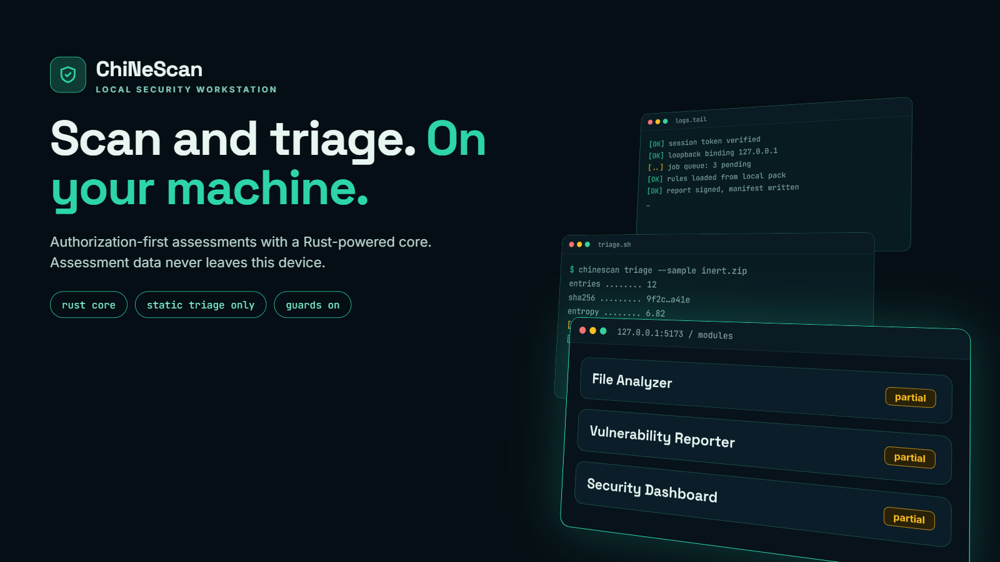

# ChiNeScan

<p align="center"></p>
<p align="center"><sub>Illustrative artwork. Terminal text in the image is decorative, not real output.</sub></p>

**Local-first security assessment workstation for code, logs, malware triage, investigations, and reports.**

**Core technologies:** Python (backend, analysis engine, CLI) · Rust (optional PyO3 redaction extension with automatic Python fallback) · TypeScript/React (web dashboard)

ChiNeScan runs assessments on the operator's machine. Local files, findings, credentials, SQLite records, and reports remain local unless an operator explicitly enables a supported network lookup or audit. The dashboard is an authenticated loopback application.

## What it does today

### Working now

- Local, heuristic code assessment for Python and JavaScript/TypeScript; indicator matching against operator-supplied local files. Findings include explanations, remediation guidance, evidence grades, and coverage accounting.
- Bounded parsing and detection for supported local log formats.
- Static malware triage of operator-managed local samples: hashes, file metadata, magic bytes, entropy, bounded strings, and indicators. Samples are not executed or uploaded.
- Local on-chain trace analysis from imported data; optional provider lookups require explicit network opt-in.
- Investigations/cases, SQLite storage, backup and recovery, and reports in JSON, JSONL, Markdown, HTML, CSV, SARIF, detail, full-json, and share-summary forms where supported by the report command. On-chain graph exports also support GraphML, graph-json, indicators, and transfers-csv formats.
- Secret redaction in logs and reports. The optional Rust extension accelerates redaction; Python fallback is automatic.
- Authenticated local dashboard for scans, findings, cases, jobs, projects, logs, malware triage, and on-chain investigations. One local operator account is supported.

### Partial

- **File Analyzer:** metadata and static indicator triage are implemented; archive listing and extension/type mismatch reporting are not.
- **Vulnerability Reporter:** exports findings and coverage from implemented assessments; it does not provide comprehensive vulnerability analysis or full language coverage.
- **Security Dashboard:** core authenticated workflows are present; alerts and per-module scores are not.
- Code assessment is heuristic, with real analyzers for Python and JavaScript/TypeScript; unsupported languages receive no equivalent language-specific analysis. No cross-file data flow or Git history analysis is performed.
- Log support is limited to implemented formats and rules; unrecognized formats and external telemetry are outside coverage.

### Planned

The capability registry marks **Network Scanner**, **Website Auditor**, and **SSL Analyzer** as planned and not implemented.

## Limits and safe use

Findings are leads for analyst review, not proof. No findings do not prove safety. Coverage gaps and scanner failures limit conclusions and are recorded where supported. Static malware triage is not an OS sandbox. Use only on assets and data you own or are explicitly authorized to assess. Domain posture checks require explicit target authorization; do not enable network options without it. The dashboard binds to loopback by default and must not be exposed publicly.

## Install

Requires Python 3.12+ and Node.js/npm for the dashboard. From PowerShell at the repository root:

```powershell
py -3.12 -m venv .venv
.\.venv\Scripts\python.exe -m pip install -e .
```

The Rust extension is optional. To build and install it with maturin (Rust toolchain required):

```powershell
.\.venv\Scripts\python.exe -m pip install maturin
Set-Location .\engine
..\.venv\Scripts\python.exe -m maturin develop
Set-Location ..
```

Build the dashboard frontend:

```powershell
Set-Location .\frontend
npm ci
npm run build
Set-Location ..
```

For local dashboard development, `scripts/start-dashboard.ps1` starts the backend on `127.0.0.1:8765` and Vite on `127.0.0.1:5173` (the helper requires `uv` and installed frontend dependencies). Alternatively run `.\.venv\Scripts\python.exe -m chinescan web serve` and `npm run dev` in separate terminals. The dashboard requires local operator sign-in.

CLI help and selected local assessment commands:

```powershell
.\.venv\Scripts\python.exe -m chinescan --help
.\.venv\Scripts\python.exe -m chinescan code .
.\.venv\Scripts\python.exe -m chinescan logs .\sample-logs
.\.venv\Scripts\python.exe -m chinescan malware analyze .\sample.bin
```

Configuration initialization does not write secrets. Default database, configuration, credentials, and reports use local user-data directories.

## Development

```powershell
.\scripts\verify-signal.ps1
.\.venv\Scripts\python.exe -m pytest -q
.\.venv\Scripts\python.exe -m ruff check .
.\.venv\Scripts\python.exe -m mypy --strict chinescan
Set-Location .\engine; cargo fmt --check; cargo clippy --all-targets -- -D warnings; cargo test
Set-Location ..\frontend; npm test -- --run; npm run lint --if-present; npm run typecheck
```

The verifier covers focused Python tests, Rust formatting/Clippy/tests when Rust sources changed, frontend tests, build, lint, and typecheck. Broader pytest, lint, and typecheck commands are shown separately.

## License

Apache-2.0. See [LICENSE](LICENSE).
